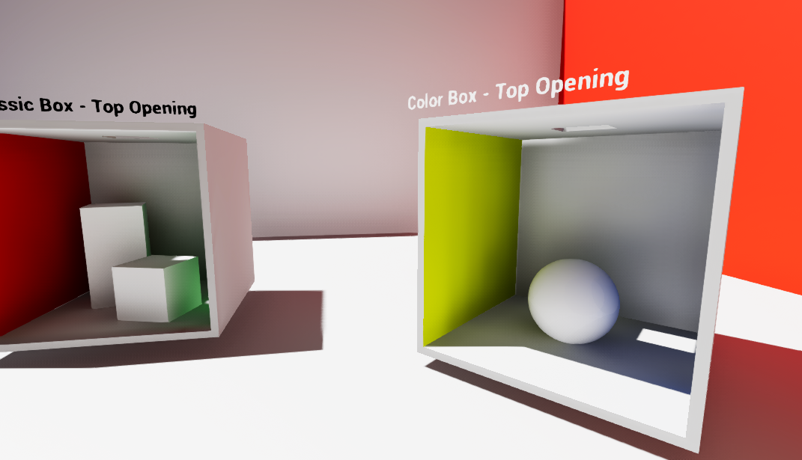

# UE5-PRT-GI

[English](README.md) | **简体中文**

UE 5.8 的静态场景 Probe GI 插件。包含 Cornell Box 示例、方向光实时重光照、1～4 次间接反弹、独立 Probe Volume 与可视化。



## 安装

通过 Git 获取此插件时需要 **Git LFS**：预计算缓存使用 LFS 保存。克隆后在插件仓库目录运行 `git lfs install --local` 和 `git lfs pull`，确保 `.surfels` / `.multi` 是实际二进制文件，而不是 LFS pointer 文本。仓库根目录就是插件目录，安装时使用下述 `Plugins/PRTGI` 路径。

1. 将插件放入 `YourProject/Plugins/PRTGI`，确保目录内直接包含 `PRTGI.uplugin`，不要额外嵌套一层仓库目录。
2. 使用与宿主项目匹配的 UE 和 C++ 工具链编译 **Editor target**。Blueprint 项目也需要能够编译此 C++ 插件的环境，必要时先添加一个 C++ 类以生成项目 target。
3. 在 **Edit → Plugins** 搜索 **UE5-PRT-GI** 并启用，按提示重启 Editor。

当前按 **Windows、UE 5.8、DX12 / SM6** 的 Deferred Rendering 路径验证。GI pass 依赖 GBuffer，当前路径不支持 Forward Shading。插件引用 Renderer 内部接口，其他 UE 版本和平台需重新编译并验证；不同 Engine Build 的预编译 DLL 不保证兼容。当前实现不要求为安装插件另行修改 Engine 源码。

## 快速运行示例

1. 在 Content Browser 勾选 **Show Plugin Content**。
2. 打开 **PRTGI Content → Maps → PRTGI_Showcase**，资源路径 `/PRTGI/Maps/PRTGI_Showcase`。
3. 点击 Editor 视口或 PIE 游戏画面，按 **Ctrl+Alt+2** 开启 PRT，按 **Ctrl+Alt+3** 比较 Lumen。
4. 按 **Ctrl+Alt+4** 检查 PRT 仅间接光，按 **Ctrl+Alt+P** 查看 Probe。
5. 按 **Ctrl+Alt+[ / ]** 旋转太阳，观察重光照结果。

本插件依赖当前 UE 5.8 Renderer 接口。Lumen 硬件光追比较要求项目启用 DX12 / SM6、Ray Tracing 和相关支持；这些属于宿主项目渲染设置，不由插件强制覆盖整个项目。

比较 Hardware Ray Tracing Lumen 时，启用 **Support Hardware Ray Tracing**、**Support Compute Skin Cache** 和 **Use Hardware Ray Tracing when available**，并使用受支持的 GPU。修改需要重启的设置后重启 Editor。详见 Epic 的 [Lumen Technical Details](https://dev.epicgames.com/documentation/en-us/unreal-engine/lumen-technical-details-in-unreal-engine)。

随附示例的默认 Map Profile 会临时设置 `r.Lumen.HardwareRayTracing=1`、`r.Lumen.ScreenProbeGather.ScreenTraces=0` 和 `r.EyeAdaptation.CachedLightingPreExposure=8`，离开地图后恢复原值。因此示例的 Lumen 比较关闭了 diffuse screen traces，并非 Lumen 默认配置。这些临时覆盖不能代替项目级硬件光追支持设置。

独立验证使用的配置见 [showcase-renderer-settings.ini](docs/showcase-renderer-settings.ini)，供宿主工程选择性合并，不会自动生效；不要用它覆盖整个项目配置。

示例使用同一盏 UE DirectionalLight；各盒子的原面光源区域已替换为开口，正面保留观察开口。

| Volume | 随附缓存 |
|---|---|
| PRT_Global、PRT_ClassicBox、PRT_ColorBox、PRT_InvertedBox | 已构建 1～4 次间接反弹数据，运行时默认 4 次 |
| PRT_ShinyBox | 已按每面 16×16 构建；878 个受检 Probe 中排除 21 个，带采集警告 |
| PRT_MetallicBox | 已按每面 16×16 构建，保持 40 cm Probe 间距与 2 cm 表面聚合尺寸；2,212 个受检 Probe 中排除 77 个，带采集警告 |

如果下载版本未附大型缓存文件，请先执行 Build Precomputation，再进行效果比较。

## 在自己的场景中添加 Probe Volume

1. 保存关卡，确认参与预计算的几何和材质保持静态。
2. 添加 UE **DirectionalLight**，将 Mobility 设为 **Movable** 以实时旋转。有多盏方向光时，为目标光源 Actor 添加 Tag `PRTGI.PrimaryLight`。
3. 在 Place Actors 搜索 **PRT Probe Volume** 并拖入场景。
4. 配置 Volume 范围、Probe 间距、Near Clip 与 Priority。
5. 开启 PRT GI，在该 Actor 的 Details → **PRT → Build** 中点击 **Build Precomputation**。
6. 等待完成，在 **PRT → Status** 检查 **Cache Status**、**GI Active**、**Effective Bounces** 和**Build Warnings**（构建警告），保存关卡。

Volume 只在 **PRT GI 模式**下参与间接光与 Probe 显示；切到 Lumen 后不会叠加 PRT GI。

### 参数说明

| 参数 | 作用 |
|---|---|
| Enabled | 是否启用此 Volume |
| Extent | 三轴半尺寸，单位 cm；Actor Scale 也影响范围 |
| Probe Spacing | 三轴目标最大间距，单位 cm；实际均匀间距见 Actual Spacing |
| Probe Inset | Probe 网格相对 Volume 边界的内缩距离，单位 cm |
| Priority | 局部密集区域使用更高优先级 |
| Near Clip Cm | Probe 采集近裁剪距离，默认 1 cm，范围 0.01～10 cm；不是主摄像机 Near Clip |
| Capture Resolution | 每个采集面的分辨率，默认 16，范围 4～32；提高会增加采集成本 |
| Transport Cell Size | 静态表面聚合尺寸，默认 2 cm，范围 1～100 cm；减小通常增加数据量和计算量 |
| Blend Face / Distance | 单个过渡面与距离（cm）：0=无，1/2=−/+X，3/4=−/+Y，5/6=−/+Z；只在需要衔接的开口处设置 |
| Display Mode | Hidden、Positions 或 Lighting；Lighting 显示 Probe 的光照颜色 |
| Probe Radius | 可视化球半径，单位 cm；不改变实际采样位置 |

Volume 当前为**轴对齐**体积，不支持旋转；每轴最多 32 个 Probe。超出限制时增大间距或拆分 Volume。

每个 Volume 还受独立的 **400 万采集样本预算**限制：`ProbeCounts.X × ProbeCounts.Y × ProbeCounts.Z × 6 × CaptureResolution²` 不得超过 4,000,000。默认分辨率 16 时，Probe 总数最多为 2,604，且仍需满足每轴限制。超出预算时降低采集分辨率、增大间距或拆分 Volume。

可从全局 Priority=0、约 200 cm 间距，局部 Priority=10、约 30～40 cm 间距开始试验，再按实际场景尺寸调整。不要把 Probe 放入墙内，也不要跨实体墙设置混合过渡。过大的 Near Clip 可能裁掉贴近 Probe 的几何，造成错误可见性或漏光。

### 预计算与进度

- 选中一个或多个 Volume，点击 **Build Precomputation** 将其加入构建队列；使用 **Cancel Build** 取消选中 Volume 的构建。
- **PRT → Build** 中的**Build Progress**（构建总进度）覆盖几何采集、传输计算和保存，**Build Stage**（构建阶段）说明当前工作；两者与构建按钮放在一起。已有有效几何缓存时会复用，可能只执行传输阶段。进度按阶段分配，不代表剩余时间估计。
- 当前构建结合 UE 场景采集与 CPU 传输预计算，运行时默认 GPU 重光照；整个 Build 不是纯 GPU 烘焙。
- 构建保存供 1～4 次间接反弹切换使用的数据。运行时切换已有反弹次数无需重新采集，默认使用 4 次。
- 用时取决于 Probe 数量、采集分辨率、几何复杂度、表面聚合尺寸及硬件。先构建小体积验证，再扩大范围。
- 静态几何、材质、网格布局或采集参数改变后需要重新构建。复制 Volume 会生成新 GUID，新副本需要自己的缓存。

几何校验异常或空采集的 Probe 会从传输与插值中排除。排除数不超过受检 Probe 的 5%，且剩余数据通过校验时，可以带警告完成构建；更大范围的异常会使构建失败。使用结果前检查**Build Warnings**（构建警告）、**Invalid Probes** 与受影响区域。采集校验使用 **Visibility** 通道的碰撞查询，因此参与几何需要与渲染表面匹配、且阻挡该通道的碰撞。

每个 Volume 的传输项上限为 **1,600 万项**，每项 64 bytes，最多约 **976.6 MiB** 传输数据；文件加载上限另留 128 MiB 存放几何索引等数据。这不是总内存预算，构建临时副本、CPU 缓存和 GPU 缓冲还会占用额外内存。不会因接近上限自动降低采集分辨率。

## 内容目录

- `Content/Maps`：示例关卡。
- `Content/Showcase/Materials`、`Meshes` 等：示例所需的项目资源副本，引用重定向到插件内部。
- `Content/Materials`：Probe 显示和几何采集材质。
- `Content/Precomputed/Volumes`：按关卡包名和 Volume GUID 隔离的 `.surfels` / `.multi` 原始缓存；不含光源参数。

`.surfels` 保存几何采集数据，配套 `.multi` 保存多次反弹传输数据；请成对保留。它们是原始二进制文件，不会作为 `.uasset` 出现在 Content Browser。缓存并非固定太阳角度的最终图像；运行时仍计算当前光源激励与遮挡，再应用预计算传输。

`/PRTGI/` 下的插件关卡写入插件目录 `Content/Precomputed/Volumes/<关卡包名>/<GUID>.prtgi.surfels`，配套文件为 `<GUID>.prtgi.surfels.multi`。其他关卡（包括自己的 `/Game/` 关卡）写入 `YourProject/Content/PRTGI/Volumes/<关卡包名>/`。关卡包名中的斜杠会替换为下划线；移动或重命名关卡会改变缓存路径，需要检查 **Cache File** 并按需重建。

插件的 Build Rules 会将自身 `Content/Precomputed` 作为松散 **NonUFS** 文件打包。使用 `/Game/` 关卡打包时，还需通过 **Additional Non-Asset Directories To Copy** 包含 `Content/PRTGI/Volumes`（相对项目 Content 的路径填写 `PRTGI/Volumes`）。请在打包产物中验证缓存加载；随附验证报告覆盖的是 Editor 使用。

## 当前限制

- PRT 计算单个选定 DirectionalLight 驱动的间接漫反射。Point、Spot、Rect Light、SkyLight 和自发光材质不会驱动此 PRT 传输；插件不提供镜面 GI 或反射。
- 参与传输的几何与材质必须保持静态。运行时光源变化时，GPU 遮挡计算复用缓存几何，移动遮挡物不会自动纳入该缓存传输。
- 曲面可能出现与 Probe 相关的环纹，亮度也可能与 Lumen 不同。进行光照比较前，请检查自己场景中的实际结果。

## 快捷键

先点击 Editor / PIE 视口，再操作。

| 快捷键 | 作用 |
|---|---|
| Ctrl+Alt+1 | 关闭动态 GI；本示例没有离线烘焙光照 |
| Ctrl+Alt+2 | PRT GI |
| Ctrl+Alt+3 | Lumen GI |
| Ctrl+Alt+4 | 切换 PRT 仅间接漫反射 / 完整画面 |
| Ctrl+Alt+P | 显示 / 隐藏 Probe；位置或光照球由 Volume Display Mode 决定 |
| Ctrl+Alt+G | 循环切换 1～4 次间接反弹，需要对应缓存 |
| Ctrl+Alt+[ / ] | DirectionalLight Yaw 减 / 加 5°（默认步长） |
| Ctrl+Alt+Shift+[ / ] | DirectionalLight Pitch 减 / 加 5°（默认步长） |
| Ctrl+Alt+B | 旧版全局烘焙入口，不会构建 Actor Volumes |

局部预计算请选中对应 `PRTProbeVolume`，点击 **Build Precomputation**。默认使用 4 次间接反弹。

快捷键受焦点或键盘布局影响时，可在 UE Console 逐条执行：

```text
PRTGI.SetMode PRT
PRTGI.SetMode Lumen
PRTGI.ToggleIndirectOnly
r.PRTGI.ShowProbes 1
r.PRTGI.Bounces 4
PRTGI.RotateLight 5 0
PRTGI.Status
```

`PRTGI.SetMode Offline` 是历史命令名称，表示退出动态 GI；它不会自动生成离线光照或 Path Tracing 参考图。
